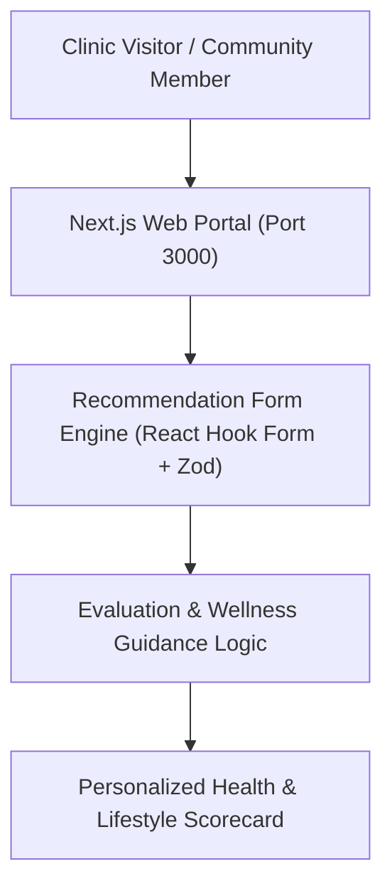
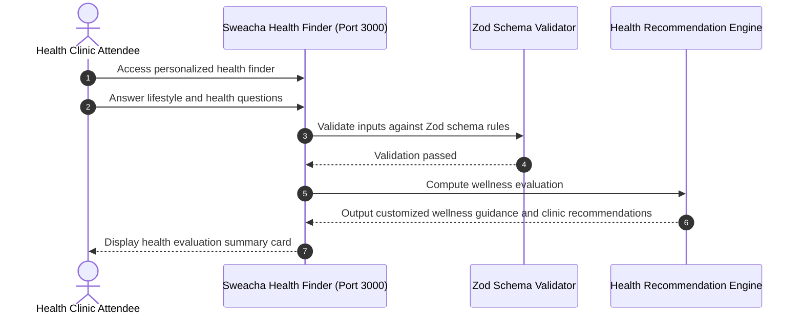

# Swecha Health & Persona Recommendation Platform
[]()
[]()
[]()
[]()

## Overview
Swecha Health & Persona Recommendation Platform is an interactive recommendation engine and user profile portal built with Next.js 15, React, Tailwind CSS, React Hook Form, and Zod validation. The application allows community members and clinic visitors to complete personalized health and lifestyle evaluations to receive curated wellness guidance, clinical recommendations, and profile records.

- **Problem Solved:** Accessible digital health questionnaires and personalized community wellness guidance.
- **Target Users:** Community clinic attendees, wellness advisors, and health volunteers.
- **Current Status:** Functional Web Application.

## Features
- **Interactive Recommendation Finder:** Step-by-step questionnaire with dynamic conditional sections.
- **Schema Validation:** Strict form validation powered by `react-hook-form` and `zod`.
- **User Profile & Verification:** Account creation, verification, and password management.
- **Responsive Community Design:** Accessible visual layout designed for diverse mobile and desktop screen sizes.

## Architecture


## User Flow


## Technology Stack
| Layer | Technology | Purpose |
|---|---|---|
| Framework | Next.js 15 (App Router) | High-speed React application architecture |
| Form Validation | React Hook Form, Zod | Type-safe form validation and state |
| Styling | Tailwind CSS, Radix UI | Modern community health UI |
| Language | JavaScript / TypeScript | Component logic and layout |

## Infrastructure
- **Server Port:** 3000
- **Build Output:** Standalone Next.js production bundle

## Project Structure
```text
sweacha-frontend/
├── main/
│   ├── src/
│   │   ├── app/             # page.tsx, finder, profile, login, signup
│   │   ├── components/      # recommendation-form, app-header, UI primitives
│   │   └── lib/             # Utilities and validation schemas
│   ├── package.json         # Dependencies
│   └── next.config.ts       # Next.js configuration
├── .gitignore               # Git ignore definitions (excluding build caches)
└── README.md                # Technical documentation
```

## Prerequisites
- Node.js 22.x (Active LTS)
- npm 10.x

## Environment Variables
Create `main/.env.local` using placeholders:
```env
NEXT_PUBLIC_APP_NAME=Swecha Health
NEXT_PUBLIC_API_URL=http://localhost:5000/api_optional
```

## Local Development Setup
1. Clone the repository:
   ```bash
   git clone https://github.com/Bhanutejanallamothu/sweacha-frontend.git
   cd sweacha-frontend/main
   ```
2. Install dependencies:
   ```bash
   npm install
   ```
3. Run development server:
   ```bash
   npm run dev
   ```
4. Access platform at `http://localhost:3000`.

## Docker Setup
*Not detected in repository. Standard Next.js container configuration supported.*

## Database Setup
*Not applicable in standalone frontend mode.*

## API Documentation
Internal form submission handlers and profile action endpoints.

## Deployment
Deploy to Vercel or Cloudflare Pages:
```bash
cd main
npm run build
```

## Security
- Accidentally committed `.idx/.next` build caches and credentials were untracked and eliminated.
- Strict input sanitization via Zod schema parsers.

## Testing
```bash
cd main && npm run lint
```

## Troubleshooting
- **Long Path Warning on Windows:** Run `git config --global core.longpaths true` if cloning on older Windows configurations.

## Future Improvements
- Multi-lingual localization supporting regional Indian languages (Telugu, Hindi, Tamil).
- PDF summary export of wellness evaluations.

## License
Open-source community project. All rights reserved by repository owner.
